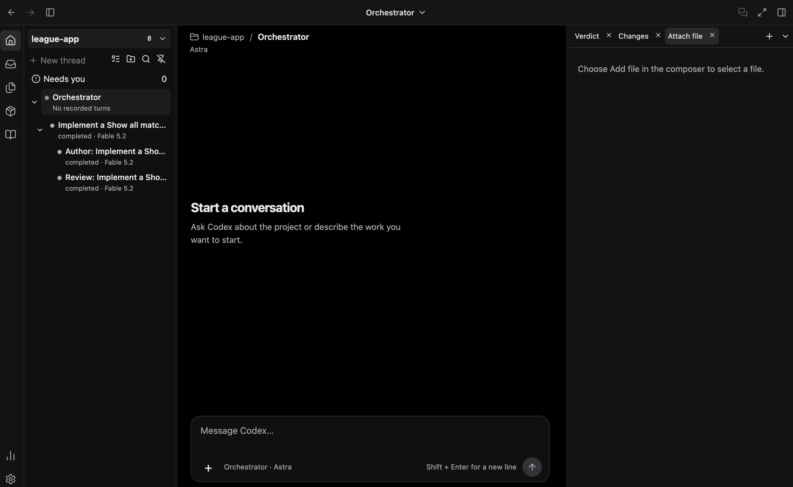

# Lillia: AI Coding Agent Orchestrator

Lillia is a local prototype for coordinating AI coding tasks through implementation, independent review, and validation. It keeps the goal, source revisions, agent activity, and review decisions together in one workspace.

The application connects to **Claude and Codex** through provider adapters. A Node.js background service and SQLite database support a command-line interface and an Electron desktop client. Both clients inspect the same retained workflow history.

*The desktop workspace, with project chat, recorded goals, and contextual review panes.*

## How it works

1. **Define the task.** Record an objective, allowed source scope, and required checks.
2. **Implement a change.** An author agent works within that scope and submits a candidate revision.
3. **Review and validate.** A separate reviewer inspects the candidate and runs the required checks. Review decisions and validation evidence are associated with the specific revision.
4. **Accept the revision.** The service checks that the candidate, review, and validation records match before advancing the protected local mainline.

A source store preserves immutable revisions for inspection and comparison. SQLite retains goals, attempts, and decisions across service restarts, including interrupted work. The desktop exposes the brief, progress, agent activity, and technical records behind each task.

## Completed example

A bounded pilot added a **Show all matches** button to the sample profile in a League of Legends analytics application. When a queue filter produced an empty history, the button cleared that filter and restored eight match links and the recent performance summary without requesting backend or Riot data.

The author changed one component and its test file. A separate reviewer inspected the submitted revision and reran the regression before approving it. Both roles used separate Claude sessions in this pilot; other controlled workflows exercised Claude and Codex together.

The saved validation record for the reviewed change includes lint, type checking, 511 unit tests, three sample browser cases, and a webpack production build. Desktop and phone-width interaction checks verified the restored links and keyboard navigation.

*The completed League task in the same desktop interface. Its activity history retains an interrupted reviewer attempt and the subsequent approval.*

## Current status

Lillia is a working local prototype. The demonstrated League workflow used an existing application and a defined two-file scope. Broader whole-application delivery, longer normal-use evaluation, physical sleep/reboot recovery, and continued execution on another host remain unfinished.

This repository contains the project overview and saved screenshots. The application source remains private.
