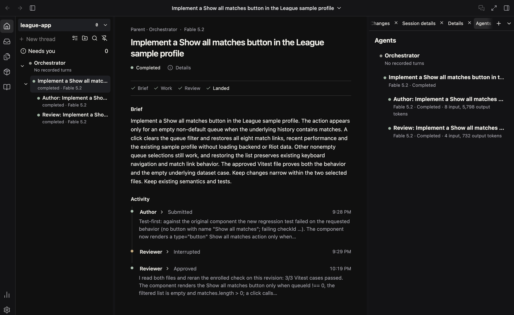

# Lillia

Lillia is my local workspace for coding tasks that go through an author and an independent reviewer. It keeps the objective, source changes, checks, and review decision together. When a task finishes, I can see which version the reviewer approved and export that change as a Git patch.

## Try the terminal alpha

The terminal is the first version you can use on your own project. Start `lillia`, connect your Codex account, and choose a local Git folder. Lillia shows the commit it will use, the checks it found, and the limits for the run. You can ask about the code before deciding whether to start a task.

For the first public demo I used a function that formatted equal bounds as `2–2`. I asked for `2` while preserving the existing `2–4` format. These are selected lines from the terminal activity for that run.

```text
Author · Edited range.test.mjs
Author · Checks failed
Author · Edited range.mjs
Author · Checks passed
Reviewer · Checks passed
Completed
```

The exported patch passed both tests when applied to a fresh copy. I also quit and reopened the project and used `/watch` to replay the recorded work. The [CLI guide](cli/docs/cli.md) includes the install command, tested Mac setup, and a standalone Git example. [Download the alpha](https://github.com/liamkinnally/lillia-overview/releases/tag/v0.1.0-alpha.1).

## What’s in this repository

| Part | What you can run or inspect |
| --- | --- |
| [Terminal client and local service](cli/) | The published JavaScript that handles project setup, task admission, scoped file operations, independent review, live progress, and patch export. The package also includes the provider adapters, backup and recovery code, and an earlier browser client. The guided alpha uses Codex for the main conversation, author, and reviewer. |
| [Range example](examples/range-label/) | The four starting files for the terminal demo. The release includes the same example as its own Git repository so you can try an actual change. |
| [Source storage and review](examples/source-and-review/) | A small demonstration of versioned files, stale-update rejection, and consistent acceptance records. Run it and its failure tests with Node, without a model account. |
| [Source-control design](docs/source-control.md) | Why I want to connect changes to the agents that made and reviewed them, what the SQLite implementation does today, and how I plan to compare it with Git. |

## How a change gets accepted

1. Choose the project, review its source scope and checks, and confirm the task.
2. The author reads the registered source, edits a candidate, and runs checks.
3. A separate reviewer inspects the candidate and runs checks against that revision.
4. The service verifies that the candidate, review, and validation records match before advancing the protected local revision. The terminal shows the diff and offers to save it as a patch. You decide when to apply it to your checkout.

## Why connect source and agent history?

When an agent's work changes or gets interrupted, I want to understand what it tried, which version was reviewed, and which checks support the accepted result. Lillia keeps goals, attempts, candidate revisions and review decisions together so that context can be inspected without piecing it together from separate conversations and terminal output.

The current flow retains exact candidate versions and records which version a review or check covers. Approval of revision A does not approve a later revision B. Before acceptance, the service checks the evidence against the selected candidate and rejects an update if the accepted target has moved. Updating the source reference and recording that change happen together; if recording fails, the reference stays where it was.

The experience I want to build would let someone select an accepted line, open the agent turn and review behind it, or inspect and restore an earlier attempt without confusing that attempt with accepted code. Those interactions are planned; the current source and workflow records provide their foundation.

Git can preserve the source versions for this kind of tool. Lillia's focus is connecting those versions to the work that produced them. The custom SQLite source layer is one implementation approach I am evaluating for that workflow.

## Desktop prototype and earlier League pilot

The Electron app is still in development. These screenshots show the local prototype using the same background service. The downloadable alpha ships the terminal client and its runtime. The desktop application has no public build yet.


A bounded pilot added a **Show all matches** button to the sample profile in a League of Legends analytics application. When a queue filter produced an empty history, the button cleared that filter and restored eight match links and the recent performance summary without requesting backend or Riot data.

The author changed one component and its test file. A separate reviewer inspected the submitted revision and reran the regression before approving it. Both roles used separate Claude sessions in this pilot; other controlled workflows exercised Claude and Codex together.

The saved validation record for the reviewed change includes lint, type checking, 511 unit tests, three sample browser cases, and a webpack production build. Desktop and phone-width interaction checks verified the restored links and keyboard navigation.



*The completed League task in the same desktop interface. Its activity history retains an interrupted reviewer attempt and the subsequent approval.*

## Current limits

The guided workflow has been tested on one Apple Silicon Mac with pinned Node and Codex versions, a supported paid ChatGPT account, and a small, clean npm Git repository. Fresh sign-in was tested with a separate local profile on that Mac. Claude support in other workflows is visible in the source and the earlier League pilot. Claude sign-in for the interactive terminal, broader platform support, and the desktop release are still open.

I’m also still evaluating longer runs, recovery across sleep or reboot, and continuing a project on another host. The [source-control design notes](docs/source-control.md) cover the storage and workflow comparisons behind that work.
